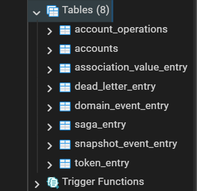
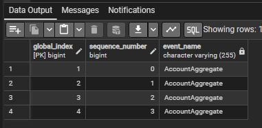
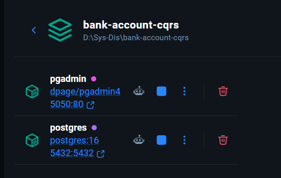

# Bank Account Management — CQRS & Event Sourcing

## 1. Présentation du projet

Ce projet consiste à développer une application de gestion de comptes bancaires en utilisant les architectures **CQRS (Command Query Responsibility Segregation)** et **Event Sourcing**, avec Spring Boot et Axon Framework.

L'objectif est de séparer les opérations de modification des données (Commandes) des opérations de consultation (Requêtes), tout en conservant l'historique des événements métier.

## 2. Technologies utilisées

| Technologie | Version / Utilisation |
|---|---|
| Java | 17 |
| Spring Boot | 3.4.12 |
| Axon Framework | 4.10.3 |
| PostgreSQL | 16 |
| Spring Data JPA | Persistance des données |
| Maven | Gestion du projet |
| Docker Compose | Conteneurisation de PostgreSQL et pgAdmin |
| Swagger / OpenAPI | Documentation et test de l'API REST |

## 3. Architecture

L'application repose sur une architecture séparant les commandes, les requêtes et les événements.

### Command Side

Le Command Side gère les modifications de l'état des comptes.

- `AddAccountCommand` : création d'un compte.
- `CreditAccountCommand` : crédit d'un compte.
- `DebitAccountCommand` : débit d'un compte.
- `UpdateAccountStatusCommand` : modification du statut.

Les commandes sont envoyées à Axon via `CommandGateway`, puis traitées par `AccountAggregate`.

### Query Side

Le Query Side permet de consulter les données sans modifier l'état du système.

- `GetAccountQuery` : consulter un compte.
- `GetAllAccountsQuery` : récupérer tous les comptes.
- `GetAccountOperationsQuery` : consulter l'historique des opérations.

Les requêtes sont envoyées via `QueryGateway` et traitées par `AccountQueryHandler`.

### Event Sourcing

Les changements métier sont représentés par des événements :

- `AccountCreatedEvent`
- `AccountCreditedEvent`
- `AccountDebitedEvent`
- `AccountStatusUpdatedEvent`

Axon Framework utilise un Event Store persistant basé sur JPA et PostgreSQL.

Les événements sont conservés dans la table `domain_event_entry`.

### Projection

`AccountEventHandler` écoute les événements et met à jour les données de lecture dans PostgreSQL.

Deux tables principales sont utilisées :

- `accounts` : état courant des comptes.
- `account_operations` : historique des opérations financières.

## 4. Structure du projet

```text
src/main/java/ma/tp/bank/
│
├── aggregates/
│   └── AccountAggregate.java
│
├── commands/
│   ├── AddAccountCommand.java
│   ├── CreditAccountCommand.java
│   ├── DebitAccountCommand.java
│   └── UpdateAccountStatusCommand.java
│
├── events/
│   ├── AccountCreatedEvent.java
│   ├── AccountCreditedEvent.java
│   ├── AccountDebitedEvent.java
│   └── AccountStatusUpdatedEvent.java
│
├── queries/
│   ├── GetAccountQuery.java
│   ├── GetAllAccountsQuery.java
│   └── GetAccountOperationsQuery.java
│
├── controllers/
│   ├── command/
│   │   └── AccountCommandController.java
│   └── query/
│       └── AccountQueryController.java
│
├── dto/
│   ├── CreateAccountRequest.java
│   ├── AmountRequest.java
│   └── UpdateAccountStatusRequest.java
│
├── entities/
│   ├── Account.java
│   └── AccountOperation.java
│
├── repositories/
│   ├── AccountRepository.java
│   └── AccountOperationRepository.java
│
└── handlers/
    ├── event/
    │   └── AccountEventHandler.java
    └── query/
        └── AccountQueryHandler.java
```

## 5. Fonctionnalités implémentées

- Création d'un compte bancaire.
- Crédit d'un compte.
- Débit d'un compte.
- Modification du statut d'un compte.
- Consultation d'un compte par son identifiant.
- Consultation de tous les comptes.
- Consultation de l'historique des opérations.
- Vérification du statut du compte avant les opérations de crédit et de débit.
- Vérification du solde disponible avant un débit.
- Persistance des événements avec Axon et PostgreSQL.
- Mise à jour des projections à partir des événements métier.

## 6. API REST

La documentation interactive est disponible avec Swagger UI.

**URL :** http://localhost:8081/swagger-ui/index.html

| Méthode | Endpoint | Description |
|---|---|---|
| POST | `/api/accounts` | Créer un compte |
| POST | `/api/accounts/{id}/credit` | Créditer un compte |
| POST | `/api/accounts/{id}/debit` | Débiter un compte |
| PUT | `/api/accounts/{id}/status` | Modifier le statut |
| GET | `/api/accounts` | Lister les comptes |
| GET | `/api/accounts/{id}` | Consulter un compte |
| GET | `/api/accounts/{id}/operations` | Consulter les opérations |

### Exemples de requêtes

**Création d'un compte**

```json
{
  "initialBalance": 1000
}
```

**Crédit**

```json
{
  "amount": 500
}
```

**Débit**

```json
{
  "amount": 300
}
```

**Modification du statut**

```json
{
  "status": "SUSPENDED"
}
```

## 7. Configuration de la base de données

Le projet utilise PostgreSQL avec les paramètres suivants pour l'environnement local :

| Paramètre | Valeur |
|---|---|
| Base de données | bankdb |
| Utilisateur | bankuser |
| Mot de passe | bankpass |
| Port PostgreSQL | 5432 |
| Port Spring Boot | 8081 |

La configuration Spring Boot se trouve dans :

`src/main/resources/application.properties`

Les principales tables utilisées sont :

| Table | Description |
|---|---|
| `accounts` | Projection des comptes |
| `account_operations` | Historique des opérations |
| `domain_event_entry` | Événements persistés par Axon |
| `association_value_entry` | Associations des agrégats |
| `dead_letter_entry` | Gestion des événements en échec |

## 8. Installation et lancement

### Prérequis

- JDK 17
- Docker Desktop
- Git

### Étape 1 — Récupérer le projet

```bash
git clone <URL_DU_DEPOT_GITHUB>
cd bank-account-cqrs
```

### Étape 2 — Démarrer PostgreSQL

```bash
docker compose up -d
```

Vérifier les conteneurs :

```bash
docker compose ps
```

Attendre que PostgreSQL soit indiqué comme `healthy`.

### Étape 3 — Lancer Spring Boot

Sous Windows PowerShell :

```powershell
.\mvnw.cmd spring-boot:run
```

L'application démarre sur :

http://localhost:8081

### Étape 4 — Accéder à Swagger

http://localhost:8081/swagger-ui/index.html

### Accès à pgAdmin

http://localhost:5050

Identifiants configurés dans Docker Compose :

- Email : `admin@bank.com`
- Mot de passe : `admin123`

Pour enregistrer le serveur PostgreSQL dans pgAdmin :

- Host : `postgres`
- Port : `5432`
- Database : `bankdb`
- Username : `bankuser`
- Password : `bankpass`

> Ces identifiants sont destinés à l'environnement local de développement. Ils doivent être remplacés par des identifiants sécurisés dans un environnement de production.

## 9. Scénario fonctionnel vérifié

Un scénario fonctionnel a été exécuté avec Swagger :

| Étape | Opération | Résultat |
|---|---|---|
| 1 | Création du compte | Solde : 1000 |
| 2 | Crédit de 500 | Solde : 1500 |
| 3 | Débit de 300 | Solde : 1200 |
| 4 | Modification du statut | SUSPENDED |
| 5 | Consultation du compte | Solde : 1200 |
| 6 | Consultation des opérations | 2 opérations retrouvées |
| 7 | Liste des comptes | Compte retrouvé |

Les tentatives de crédit et de débit sur un compte suspendu ont également été refusées.

### Vérification de l'Event Store

Les événements suivants ont été retrouvés dans `domain_event_entry` :

| Séquence | Événement |
|---|---|
| 0 | AccountCreatedEvent |
| 1 | AccountCreditedEvent |
| 2 | AccountDebitedEvent |
| 3 | AccountStatusUpdatedEvent |

Le scénario a donc produit quatre événements persistés pour le compte testé.

## 10. Captures d'écran

Les captures suivantes illustrent le fonctionnement de l'application, son API REST et son environnement technique.

### 1. Documentation de l'API avec Swagger


### 2. Création d'un compte bancaire


### 3. Consultation des informations du compte


### 4. Historique des opérations


### 5. Tables de la base de données PostgreSQL



### 6. Événements persistés dans l'Event Store



### 7. Conteneurs Docker



## 11. État actuel du développement

| Fonctionnalité | État           |
|---|----------------|
| Configuration Spring Boot | Terminée       |
| Configuration PostgreSQL | Terminée       |
| Commandes Axon | Implémentées   |
| Account Aggregate | Implémenté     |
| Événements métier | Implémentés    |
| Event Store JPA | Vérifié        |
| Event Handlers | Implémentés    |
| Projections PostgreSQL | Fonctionnelles |
| Query Handlers | Implémentés    |
| API REST Command | Fonctionnelle  |
| API REST Query | Fonctionnelle  |
| Documentation Swagger | Fonctionnelle  |
| Tests manuels des endpoints | Réalisés       |
| Tests automatisés | Réaliser       |
| Gestion centralisée des exceptions | À améliorer    |

## 12. Conclusion

Cette première version met en œuvre les principes fondamentaux de CQRS et Event Sourcing avec Spring Boot, Axon Framework et PostgreSQL.

La séparation entre les commandes et les requêtes, la persistance des événements métier dans l'Event Store et la mise à jour des projections constituent la base fonctionnelle de l'application.

Des améliorations restent possibles, notamment l'ajout de tests automatisés et l'amélioration de la gestion centralisée des exceptions.